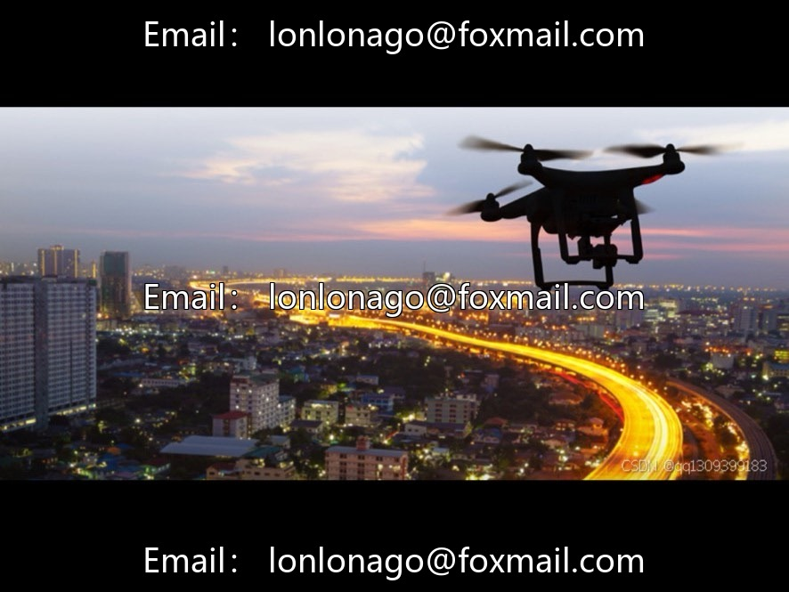
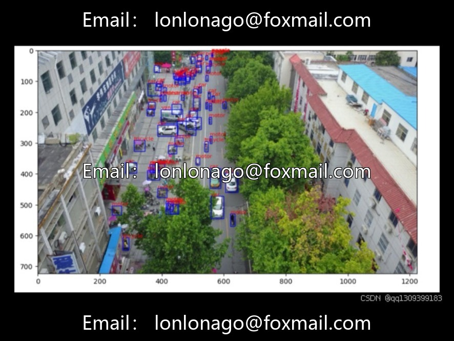
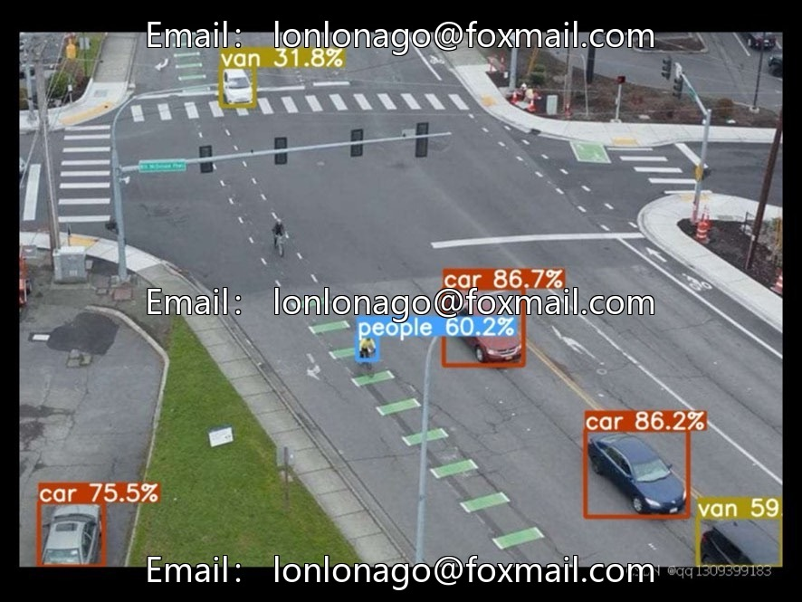

# 2019 Drone Dataset, VisDrone mainstream data in the field of drone vision.

## Body

2019 Drone Dataset, VisDrone, a mainstream dataset in the field of drone vision. It was collected from 14 Chinese cities, covering diverse scenarios such as urban areas, rural areas, roads, and farmlands, supporting applications like drone surveillance and traffic inspection.

The dataset is released by the Machine Learning and Data Mining Laboratory of Tianjin University, suitable for algorithm research such as drone target detection and recognition. The model, code, and experimental environment are not restricted by geography, and can be run worldwide.

Virtual materials, once sold, are non-refundable.
Interested friends, click "I want" to proceed.

## Images

## Payment

Here is a pay link on Stripe ( https://buy.stripe.com/3cs8yP7sY87d0vu9AB ). Please contact me lonlonago@foxmail.com after funding $89, and I will send you a complete data files , thank you!

